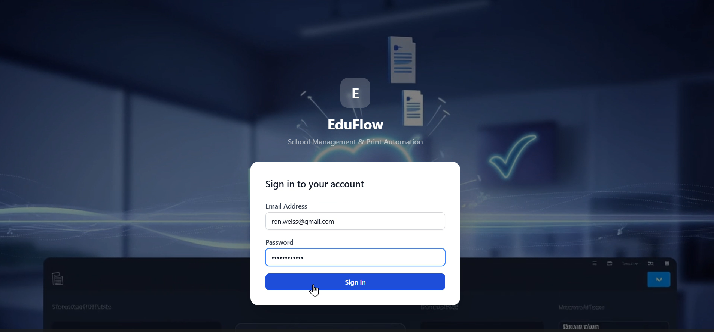
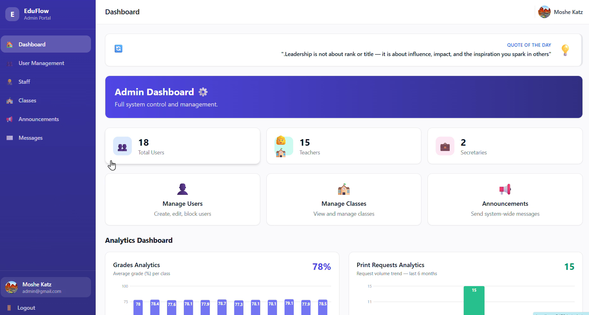
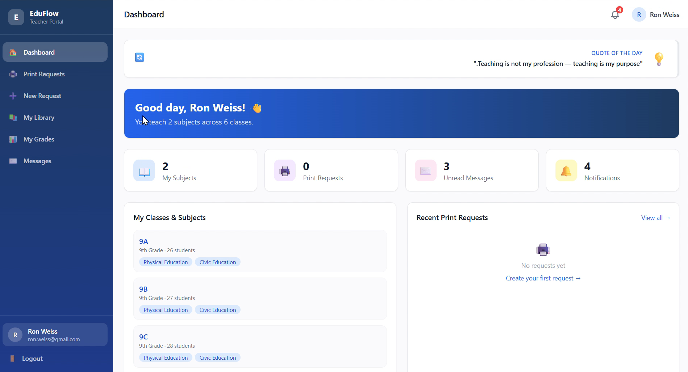
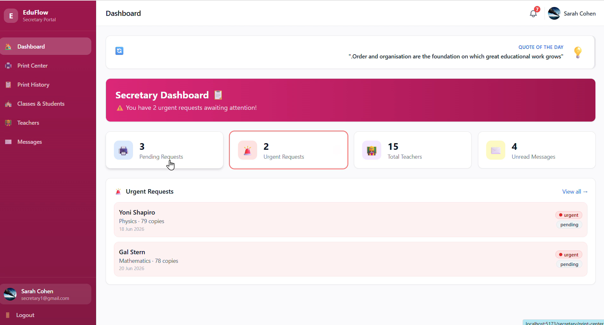
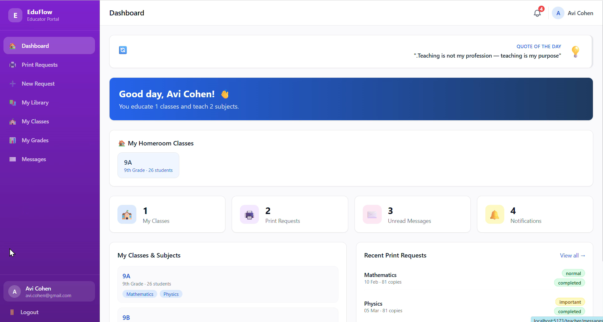
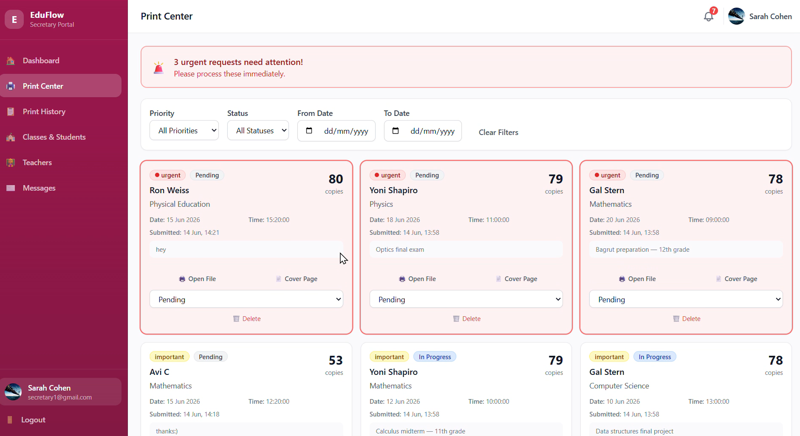
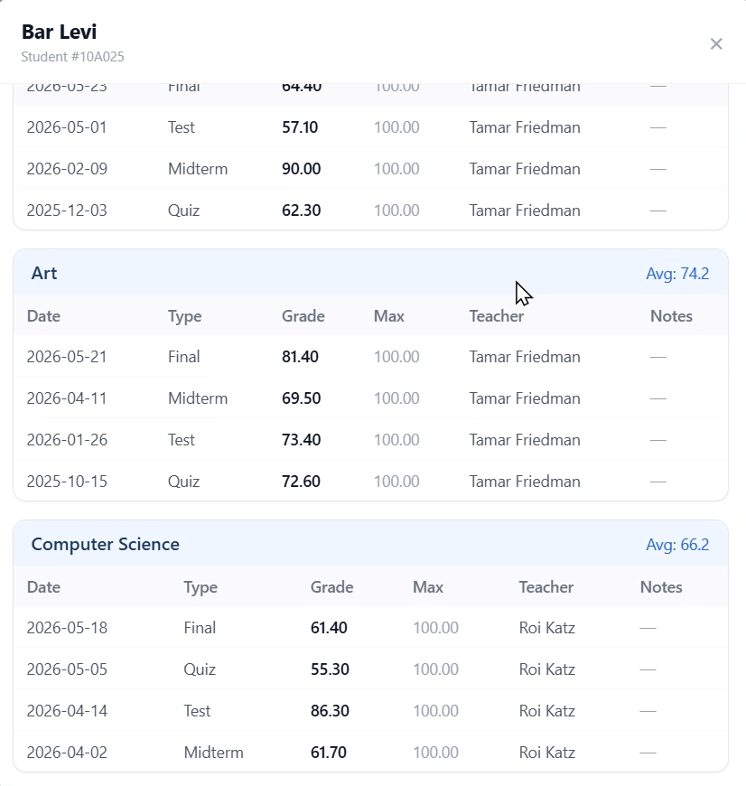
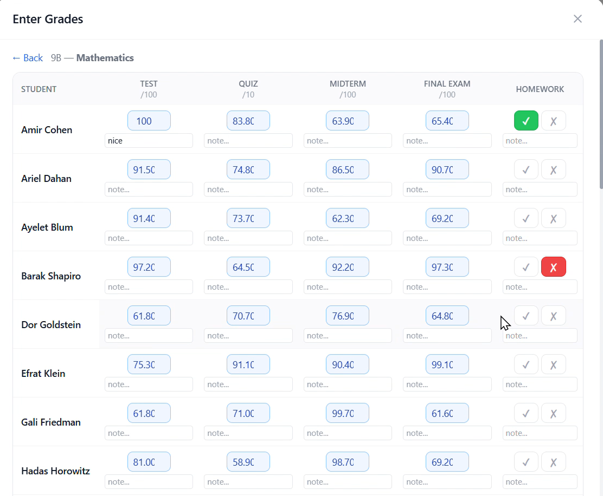
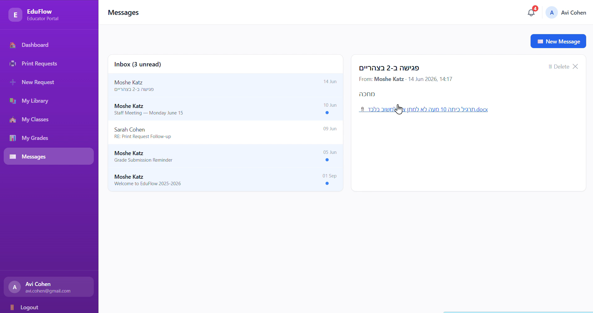
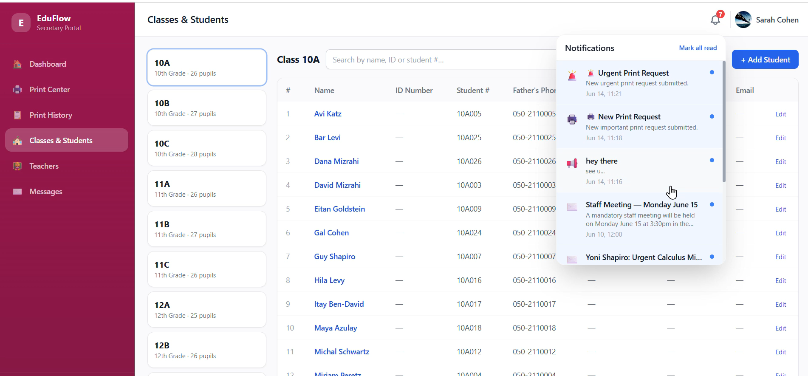

# 🎓 EduFlow

> **A production-ready full-stack school management platform featuring real-time collaboration, print workflow automation, grade management, internal messaging, and role-based access control. It is a Capstone Project for my Software Development  Course at TS Acdemy**

> 🚧 **Roadmap:** EduFlow is currently being expanded into a multi-school (multi-tenant) platform for real-world deployment.

<p align="center">
  <a href="https://eduflow-production-53fe.up.railway.app">
    
  </a>
</p>


---

# 📸 Screenshots

### Login



### Administrator Dashboard



### Teacher Dashboard



### Secretary Dashboard



### Homeroom Teacher Dashboard



### Print Queue



### Student Grades Overview



### Grades Management



### Messaging



### Notifications



---

# 📖 Overview

EduFlow is a production-ready full-stack web application designed to digitize and streamline daily school operations.

Instead of relying on paperwork and manual communication, EduFlow provides a centralized platform for managing print requests, student grades, messaging, notifications, classroom administration, and user management.

The platform combines a modern React frontend with a secure Node.js backend and a MySQL database while delivering real-time communication through Socket.IO.

---

# 👥 Role-Based Experience

EduFlow provides a dedicated experience for every user role.

- 👨‍💼 Administrator
- 🖨 Secretary
- 👩‍🏫 Teacher
- 👩‍🏫 Homeroom Teacher

Each role has its own dashboard, permissions, navigation, and business workflow.

---

# ✨ Key Features

- Real-time school workflow management
- Dashboard tailored for every user role
- Print request automation
- Student grade management
- Internal messaging system
- Real-time notifications using Socket.IO
- JWT Authentication
- Role-Based Access Control (RBAC)
- File uploads
- PDF cover generation
- Responsive modern UI
- RESTful API
- Secure backend architecture

---

# 👥 User Roles

## 👨‍💼 Administrator

- Full user management
- Teacher & Homeroom Teacher assignment
- Class management
- School notifications
- Administrative dashboard
- System configuration

---

## 🖨 Secretary

- Manage print requests
- Update print status
- Generate PDF cover pages
- Student management
- Teacher profiles
- Internal messaging

---

## 👩‍🏫 Teacher

- Submit print requests
- Upload teaching materials
- Manage personal file library
- Grade students
- Receive real-time notifications
- Internal messaging

---

## 👩‍🏫 Homeroom Teacher

Includes every Teacher capability plus:

- Manage homeroom students
- View all student grades
- Contact teachers assigned to the class
- Dedicated homeroom dashboard

---

# 🔄 Print Workflow

```text
Teacher
      │
      ▼
Submit Print Request
      │
      ▼
Secretary receives real-time notification
      │
      ▼
Processing
      │
      ▼
Printed
      │
      ▼
Completed
```

Teachers receive live status updates throughout the entire process.

---

# ⚡ Real-Time Features

EduFlow uses **Socket.IO** to synchronize users instantly.

Real-time capabilities include:

- New print request notifications
- Print status updates
- Internal messages
- School notifications

No manual page refresh is required.

---

# 🔐 Security

- JWT Authentication
- Password hashing (bcrypt)
- Role-Based Authorization (RBAC)
- Joi request validation
- Parameterized SQL queries
- Helmet security middleware
- Express Rate Limiter
- File type validation
- Protected API routes

---

# 🏗 Architecture

```text
React + Vite
        │
Axios + Socket.IO
        │
REST API
        │
Node.js + Express
        │
Controllers
        │
Services
        │
Data Access Layer
        │
MySQL
```

---

# 🛠 Tech Stack

## Frontend

- React
- Vite
- React Router
- Tailwind CSS
- Zustand
- Axios
- React Hook Form
- Zod
- Socket.IO Client

## Backend

- Node.js
- Express.js
- JWT
- bcrypt
- Joi
- Multer
- PDFKit
- Socket.IO
- Helmet
- express-rate-limit

## Database

- MySQL

---
# 🌐 Live Demo

EduFlow ships with a single `Dockerfile` that builds the React client and
bundles it inside the Node/Express server, so the whole app deploys as
**one service with one URL**. The fastest free option is **Railway**
(built-in MySQL, auto-detects the Dockerfile, deploys straight from GitHub):

1. Go to [railway.app](https://railway.app) → **New Project** → **Deploy from GitHub repo** → select `EduFlow`.
2. In the same project, click **+ New** → **Database** → **Add MySQL**.
3. Open the service's **Variables** tab and set:
   - `DB_HOST`, `DB_PORT`, `DB_USER`, `DB_PASSWORD`, `DB_NAME` → copy these from the MySQL plugin's "Connect" tab (Railway auto-generates them; reference them with `${{MySQL.MYSQLHOST}}` etc., or paste the values directly).
   - `JWT_SECRET` → any long random string.
   - `NODE_ENV=production`
4. Once the MySQL service is running, open its **Data** tab (or connect with any MySQL client using the credentials from step 3) and import the schema:
   ```bash
   mysql -h <DB_HOST> -P <DB_PORT> -u <DB_USER> -p<DB_PASSWORD> <DB_NAME> < database/seed_full.sql
   ```
5. Railway builds the `Dockerfile` automatically and gives you a public URL (Settings → **Generate Domain**). That URL *is* your Live Demo link — log in with one of the [Demo Accounts](#-demo-accounts) below.

Once deployed, put the URL in your GitHub repo's "About" section (the ⚙️ gear icon next to About → Website) so it shows up as a clickable link on your profile/README.

> Prefer Render, Fly.io, or a VPS instead? They all support "deploy from Dockerfile" the same way — just point them at this repo and set the same environment variables (see `server/.env.example`).

---

# 🚀 Getting Started

## Database

```bash
mysql -u root -p eduflow < database/seed_full.sql
```

## Backend

```bash
cd server
npm install
npm run dev
```

## Frontend

```bash
cd client
npm install
npm run dev
```

Open:

```text
http://localhost:5173
```

---

# 👤 Demo Accounts

| Role | Email | Password |
|------|-------|----------|
| Administrator | admin@gmail.com | Password123! |
| Secretary | secretary@gmail.com | Password123! |
| Teacher | teacher1@gmail.com | Password123! |
| Homeroom Teacher | TeacherEducator@gmail.com | Password123! |

---

# 🛣 Roadmap

- Multi-school (Multi-Tenant) architecture
- Cloud deployment
- Email notifications
- Analytics dashboard
- Docker support
- CI/CD pipeline
- Unit Testing
- Integration Testing

---

# 👩‍💻 Author

**Ahuva Fogel**

Software Developer specializing in Backend Development, Full-Stack Applications, Database Systems, Software Architecture, and AI-powered solutions.

**GitHub:** https://github.com/af-programmer
